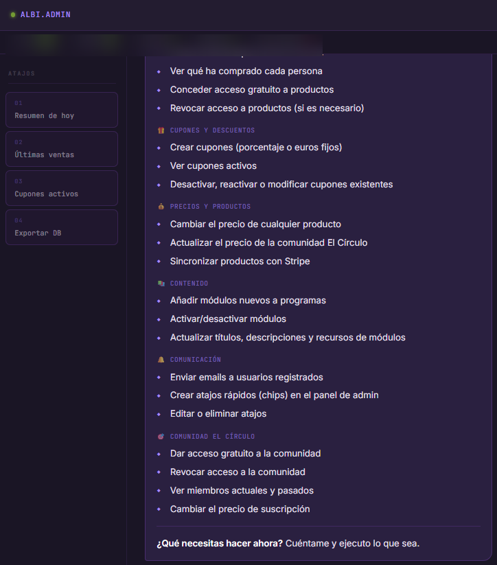

# La Asignatura Pendiente

> Plataforma web full-stack para una psicóloga: venta de programas, comunidad privada, contenido protegido y dos agentes de IA que atienden a usuarios y gestionan el negocio.

**Web en producción:** [asignaturapendiente.es](https://asignaturapendiente.es)

Este repositorio es un **escaparate** (showcase). El código fuente es privado por tratarse de un proyecto de cliente, pero aquí encontrarás la arquitectura, las decisiones técnicas y capturas de la aplicación real.

---

## Qué es

Una web profesional completa, no una landing. Un usuario puede registrarse, comprar un programa con tarjeta, acceder a su contenido protegido (vídeos, audios y PDFs), unirse a una comunidad privada tipo red social y conversar con un asistente de IA disponible 24/7. La dueña del negocio gestiona absolutamente todo (ventas, precios, cupones, accesos, contenido y comunidad) conversando con un segundo agente de IA, sin tocar una sola tabla ni formulario de administración.

La filosofía del proyecto es **AI-First**: la IA no es una funcionalidad añadida, es la capa de gestión del negocio.

---

## Capturas

### Home

### Página de programa

### Checkout con descuentos, packs y upsells

### Pago seguro con Stripe

### Dashboard del usuario (contenido comprado)

### Comunidad "El Círculo" (PWA)

### Agente público de atención (NEBULA.ia)

### Agente de gestión del negocio (ALBI.ADMIN)

---

## Stack técnico

| Capa            | Tecnología                                  |
| --------------- | ------------------------------------------- |
| Framework       | Astro 6 (SSR en Vercel)                     |
| Estilos         | Tailwind CSS + CSS custom properties        |
| Backend         | Astro API Routes (TypeScript estricto)      |
| Base de datos   | Neon PostgreSQL + Drizzle ORM               |
| Autenticación   | JWT propio (jose) + Google OAuth            |
| Pagos           | Stripe (Checkout + webhooks)                |
| Email           | Resend                                      |
| IA              | Vercel AI SDK + Claude (Anthropic) + Gemini |
| Almacenamiento  | Vercel Blob                                 |
| Push (PWA)      | web-push (notificaciones de la comunidad)   |
| Deploy          | Vercel (Node 24, Fluid Compute)             |
| Gestor paquetes | pnpm                                        |

---

## Características principales

### Tienda y pagos

- Catálogo de programas, retos y meditaciones servidos desde base de datos.
- Checkout con descuentos por fidelidad, packs, upsells y cupones.
- Integración real con Stripe: creación de sesiones de pago y webhooks con verificación de firma e idempotencia.
- Acceso al contenido desbloqueado automáticamente tras la compra.

### Autenticación propia

- Registro y login con JWT firmado (access token en memoria, refresh token en cookie httpOnly).
- Login con Google OAuth.
- Verificación de email, recuperación de contraseña y rotación de refresh tokens.
- Rate limiting persistido en base de datos.

### Contenido protegido

- Vídeos de YouTube no expuestos en el HTML inicial: se sirven vía fetch autenticado.
- Módulos con vídeo, audio y PDF, accesibles solo por quien ha comprado.

### Comunidad "El Círculo" (PWA)

- Red social privada con espacios temáticos, publicaciones, comentarios, reacciones y encuestas.
- Mensajería directa con la psicóloga.
- Notificaciones push.
- Moderación inline para el rol admin (fijar, bloquear, borrar).
- Suscripción de pago independiente gestionada con Stripe.

### Dos agentes de IA

Detalle completo en [docs/agentes-ia.md](docs/agentes-ia.md).

- **Agente público (NEBULA.ia):** atención al visitante 24/7. Recomienda programas, resuelve dudas y orienta. 5 tools de solo lectura.
- **Agente de gestión (ALBI.ADMIN):** la dueña gestiona el negocio entero conversando (ventas, cupones, precios, accesos, contenido, emails y comunidad). 29 tools, muchas con capacidad de escritura.

---

## Arquitectura

Documentación ampliada en [docs/arquitectura.md](docs/arquitectura.md).

- **~70 API routes** organizadas por dominio (auth, payments, community, ai, user, admin).
- **35 tablas** modeladas con Drizzle ORM, con migraciones versionadas y separación de entorno develop/producción.
- **Capa de utilidades de backend** reutilizable (`lib/server/`): db, jwt, cors, rate limiting, email, stripe, gates de comunidad.
- **Middleware de Astro** para proteger rutas y resolver sesión.

En [docs/patrones.md](docs/patrones.md) hay ejemplos ilustrativos de los patrones clave (verificación de webhooks, tools de IA, autorización por token y manejo de cookies).

---

## Seguridad

Las decisiones de seguridad están documentadas en [docs/seguridad.md](docs/seguridad.md). En resumen:

- Verificación de firma en webhooks **antes** de procesar nada, con control de idempotencia.
- Tokens separados: access token en memoria JS, refresh token en cookie httpOnly.
- Todas las queries filtradas por el `user_id` del JWT, nunca por parámetros del cliente.
- CORS restringido al dominio de producción.
- Contraseñas con bcrypt (salt rounds 12).
- Variables sensibles solo en el entorno de Vercel, nunca en el código.
- Guardarraíles propios para los agentes de IA (validación de entrada y límites de acción).

---

## Sobre este proyecto

Construido de principio a fin como proyecto real para un cliente, dirigiendo el desarrollo con **Claude Code**. Es la pieza más completa de mi portfolio: combina frontend, backend, base de datos, pagos reales, una PWA y dos agentes de IA en producción.

**Iván Pascual**
[ivanpascual988@gmail.com](mailto:ivanpascual988@gmail.com)

---

© 2026 Iván Pascual. Todos los derechos reservados.
Este repositorio es un escaparate. El código fuente es privado.