# La Asignatura Pendiente

> Plataforma web full-stack para una psicóloga: una escuela de educación mental con programas, prácticas de 21 días, talleres en directo, comunidad privada de pago y dos agentes de IA que atienden a visitantes y gestionan el negocio.

**Web en producción:** [asignaturapendiente.es](https://asignaturapendiente.es)

Este repositorio es un **escaparate** (showcase). El código fuente es privado por tratarse de un proyecto de cliente, pero aquí encontrarás la arquitectura, las decisiones técnicas y capturas de la aplicación real.

---

## Qué es

Una web profesional completa, no una landing. Gira en torno a una idea: **una sola asignatura, la mente, y seis lecciones** (pensamientos, atención, emociones, creencias, identidad y conciencia). Sobre esa idea se construye todo el producto:

- Un visitante puede hacer el **test del mapa mental** y recibir por correo qué lección le toca trabajar primero.
- Puede comprar un **programa**, apuntarse a la **lista de espera** de uno que aún no está a la venta, o seguir una **práctica de 21 días** que se desbloquea día a día desde la compra.
- Puede inscribirse a un **taller en directo** sin crear cuenta y recibir la sala y los recordatorios por correo.
- Puede unirse a **El Círculo**, una comunidad privada de suscripción mensual instalable como PWA.
- Y puede preguntar a una asistente de IA a cualquier hora, con datos reales del catálogo.

La dueña del negocio gestiona ventas, precios, cupones, accesos, comunidad, talleres y métricas de la web **conversando con un segundo agente de IA**. La carga de contenido (vídeos, audios y PDF de cada día) la hace desde un estudio visual propio.

La filosofía del proyecto es **AI-First**: la IA no es una funcionalidad añadida, es la capa de gestión del negocio.

---

## Capturas

### Portada

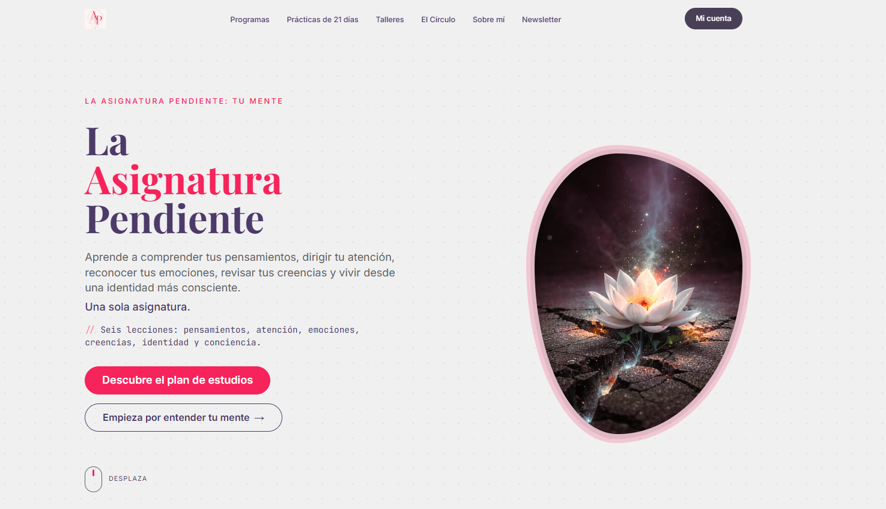

### Programas

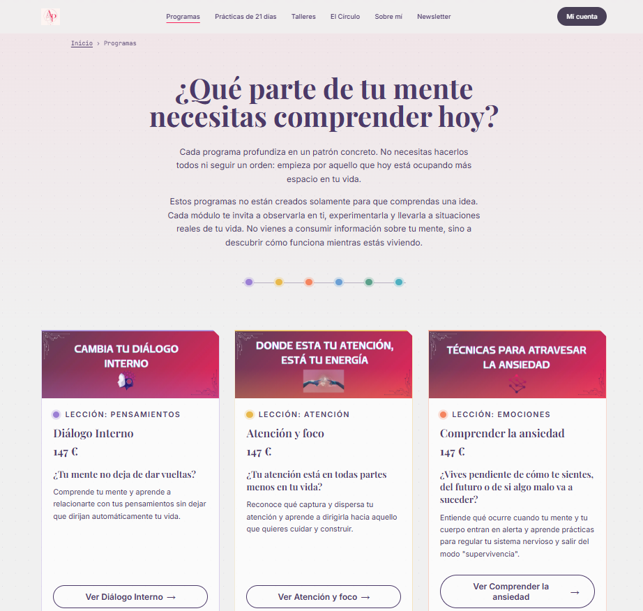

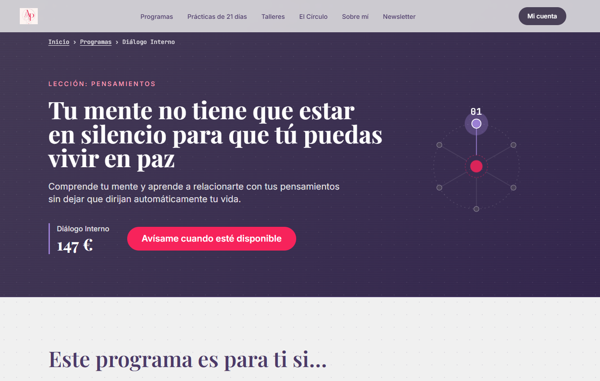

### Prácticas de 21 días

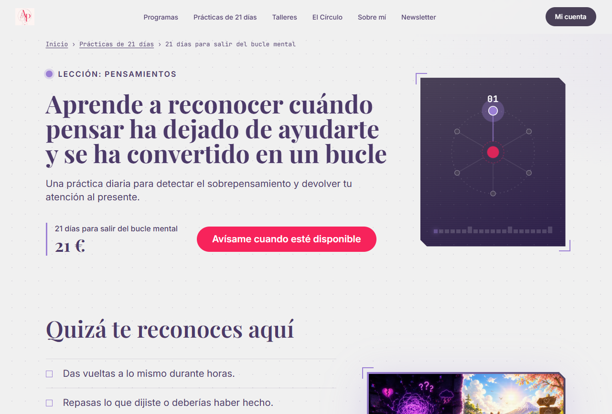

### Test del mapa mental

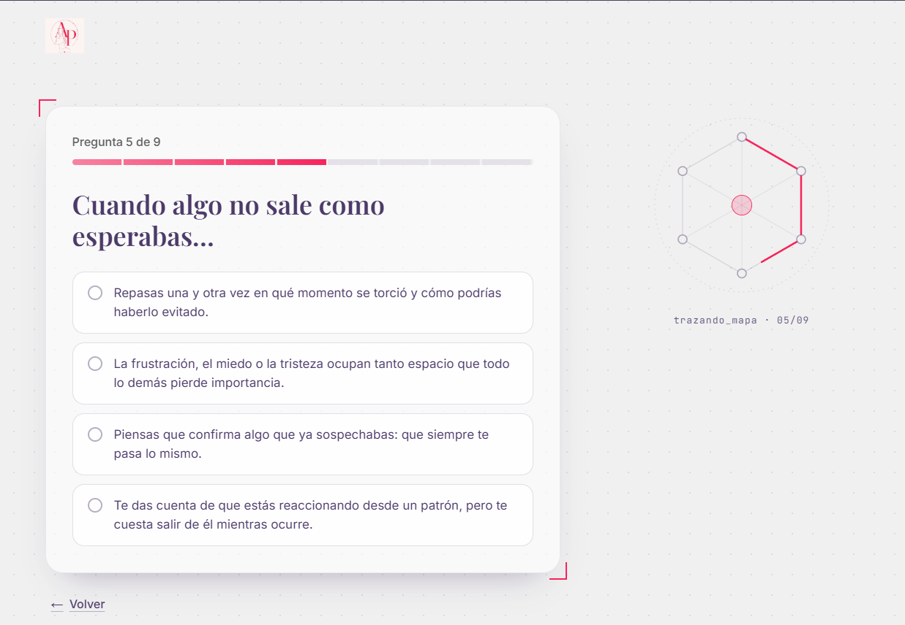

### Talleres en directo

### Checkout con consentimiento de desistimiento y pago con Stripe

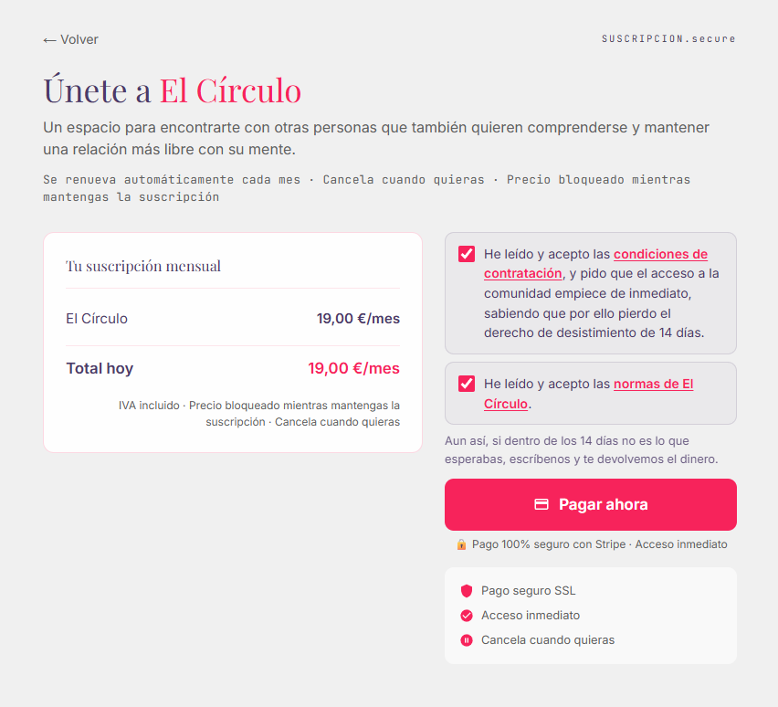

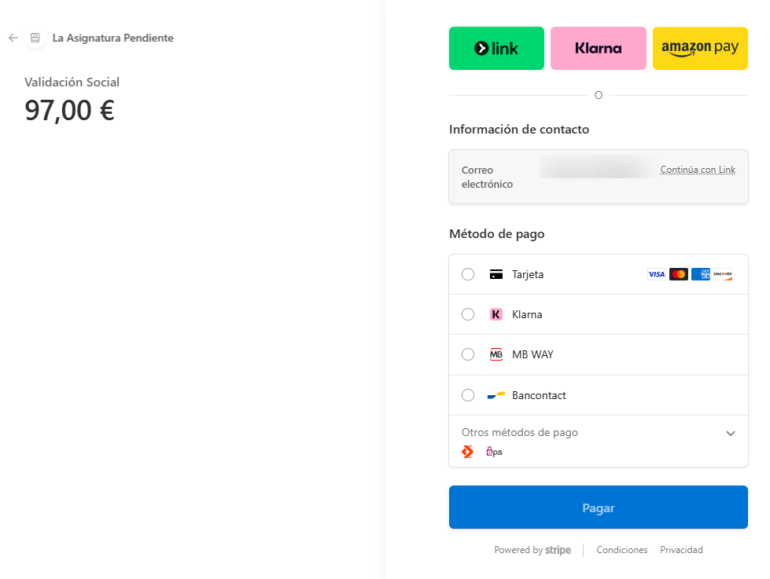

### Mi cuenta

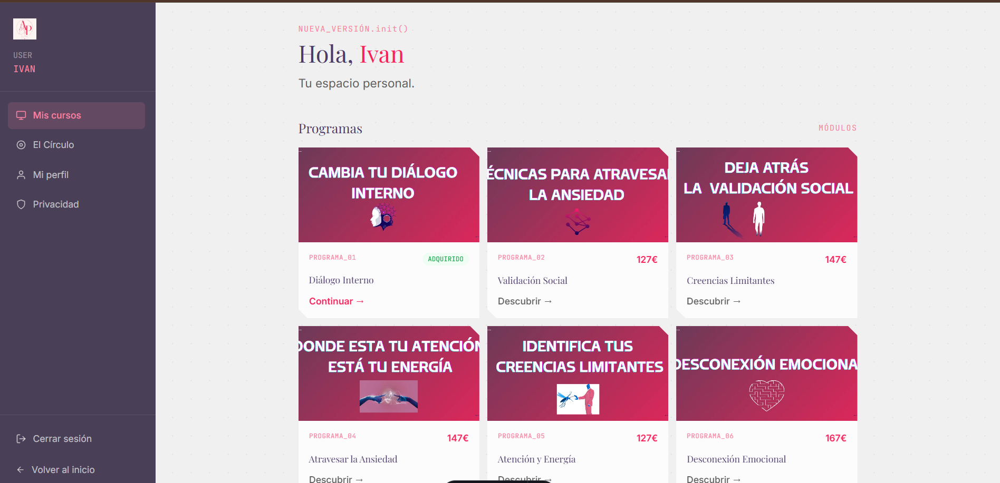

### Área de alumno: un día de una práctica

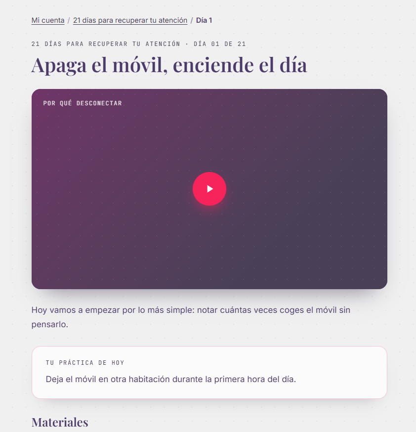

### Comunidad "El Círculo" (PWA)

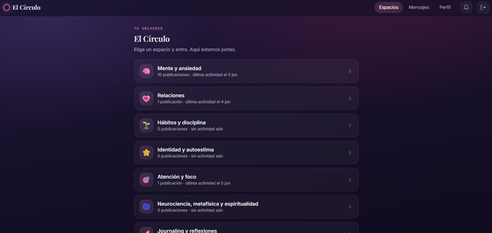

### Agente público de atención (NEBULA.ia)

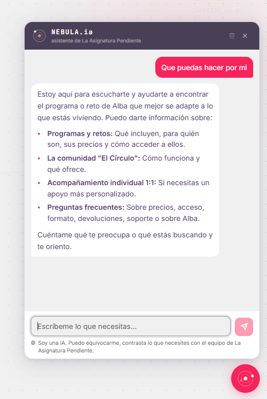

### Agente de gestión del negocio (MENTOR.IA)

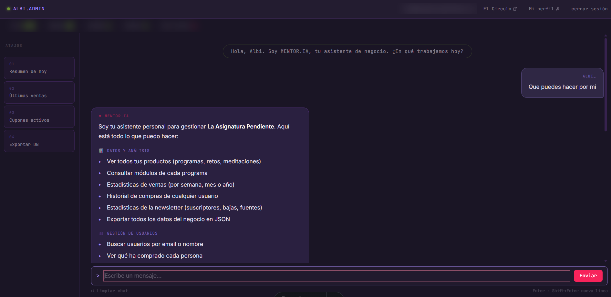

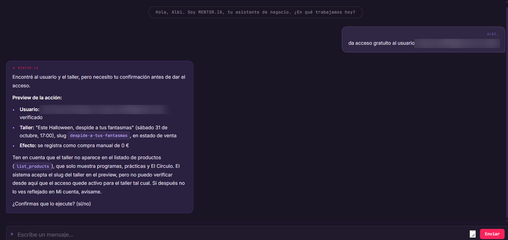

### Estudio de contenido

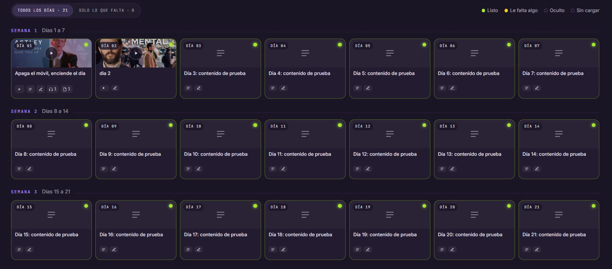

---

## Stack técnico

| Capa            | Tecnología                                            |
| --------------- | ----------------------------------------------------- |
| Framework       | Astro 7 (SSR en Vercel)                               |
| Estilos         | Tailwind CSS + CSS custom properties, fuentes autoalojadas |
| Backend         | Astro API Routes (TypeScript estricto)                |
| Base de datos   | Neon PostgreSQL + Drizzle ORM                         |
| Autenticación   | JWT propio (jose) + Google OAuth                      |
| Pagos           | Stripe (Checkout, suscripciones, reembolsos y webhooks) |
| Email           | Resend (transaccionales, programados y webhook de entregas) |
| IA              | Vercel AI SDK + Claude (Anthropic) + Gemini (Google)  |
| Almacenamiento  | Vercel Blob (público para la comunidad, privado para el contenido de pago) |
| Analítica       | GA4 con consentimiento + Search Console, leídos desde el agente |
| Push (PWA)      | web-push (notificaciones de la comunidad)             |
| Tareas programadas | Vercel Cron (3 trabajos diarios)                   |
| Calidad         | Biome, `node:test`, CI en GitHub Actions              |
| Deploy          | Vercel (Node 24)                                      |
| Gestor paquetes | pnpm                                                  |

---

## Características principales

### Tienda y pagos

- Catálogo de programas, prácticas y talleres servido desde base de datos, con Stripe como espejo sincronizado.
- Checkout con descuentos por fidelidad, multi-producto, packs y cupones, con un único cálculo de precio compartido por lo que se muestra y lo que se cobra.
- Consentimiento expreso de desistimiento antes de dar acceso inmediato a contenido digital.
- Webhook de Stripe con verificación de firma, idempotencia por acceso esperado y manejo de reembolsos, pagos asíncronos y renovaciones de suscripción.
- Una práctica de 21 días no se puede cobrar hasta que tiene sus 21 días cargados: lo impide el checkout, no una nota.

### Captación: lista de espera y test del mapa mental

- Lista de espera por producto con doble confirmación por correo; un cron avisa a quien espera cuando el producto pasa a venta.
- Test del mapa mental: motor de puntuación propio que devuelve la lección principal y secundaria, entregado por correo tras confirmar la dirección.
- Altas sin confirmar purgadas automáticamente a los 7 días.

### Contenido protegido

- Prácticas de 21 días con desbloqueo por calendario a partir de la compra.
- Vídeos de YouTube no listados que nunca aparecen en el HTML inicial: se piden por API tras verificar compra y día desbloqueado.
- Audios y PDF en un almacén privado, servidos con URL firmada de vida corta.
- Seguimiento de progreso por alumno, visible para la dueña en el estudio y desde el chat.

### Talleres en directo

- Inscripción sin cuenta, pagada con Stripe.
- Correos programados (víspera y una hora antes), sala visible en Mi cuenta 15 minutos antes y material en PDF tras el taller.
- Si cambia la sala después de enviar los recordatorios, se avisa a las inscritas una sola vez por cambio.

### Autenticación propia

- Registro y login con JWT firmado (access token de vida corta, refresh token rotado en cookie httpOnly).
- Login con Google OAuth.
- Verificación de email, recuperación de contraseña y consentimiento RGPD exigido en servidor.
- Rate limiting persistido en base de datos.

### Comunidad "El Círculo" (PWA)

- Red social privada con espacios temáticos, publicaciones, comentarios, reacciones y encuestas.
- Normas que hay que aceptar para entrar, aplicadas en el gate del servidor.
- Mensajería directa con la psicóloga y notificaciones push.
- Moderación a la vista para el rol admin (fijar, bloquear, borrar).
- Suscripción mensual con Stripe, portal de facturación y apertura o cierre de altas desde el chat.

### SEO, accesibilidad y analítica

- Datos estructurados JSON-LD, migas de pan, canónicas, sitemap, imagen para compartir y `llms.txt`.
- GA4 que no se carga hasta aceptar cookies, solo en páginas públicas indexables y con un catálogo cerrado de eventos.
- Cabeceras de seguridad y CSP diferenciadas para zona pública y privada.

### Dos agentes de IA

Detalle completo en [docs/agentes-ia.md](docs/agentes-ia.md).

- **Agente público (NEBULA.ia):** atención al visitante 24/7. Recomienda programas, prácticas y talleres, resuelve dudas y orienta. 5 tools de solo lectura, filtro de enlaces y protocolo de crisis impuesto en código.
- **Agente de gestión (MENTOR.IA):** la dueña gestiona el negocio conversando. 36 tools, de las cuales 13 (las que escriben, cobran, envían o exportan) exigen una confirmación que el modelo no puede saltarse.

---

## Arquitectura

Documentación ampliada en [docs/arquitectura.md](docs/arquitectura.md).

- **93 API routes** organizadas por dominio (auth, payments, content, community, talleres, ai, admin, cron...).
- **43 tablas** modeladas con Drizzle ORM y 36 migraciones versionadas, con un guardarraíl que bloquea migraciones peligrosas y separación de entorno develop/producción.
- **Capa de utilidades de backend** (`lib/server/`) con la lógica de negocio crítica extraída a funciones puras y testeadas.
- **42 ficheros de test** y CI que exige typecheck, linter sin avisos, tests y build en cada PR.

En [docs/patrones.md](docs/patrones.md) hay ejemplos ilustrativos de los patrones clave (webhooks, confirmación impuesta en código, tools de IA, autorización por token y cookies).

---

## Seguridad

Las decisiones de seguridad están documentadas en [docs/seguridad.md](docs/seguridad.md). En resumen:

- Verificación de firma en los webhooks de Stripe y Resend **antes** de procesar nada, con idempotencia.
- Tokens separados: access token de vida corta, refresh token rotado en cookie httpOnly.
- Todas las queries filtradas por el `user_id` del JWT, nunca por parámetros del cliente.
- Contenido de pago fuera del HTML y materiales con URL firmada de vida corta.
- CSP y cabeceras de seguridad por zona; CORS restringido al dominio de producción.
- Guardarraíles de IA que son barreras de código, no instrucciones de prompt: confirmación verificada contra el historial, retirada de tools ante una crisis y filtro de enlaces inventados.
- RGPD: exportación y borrado de cuenta, consentimientos separados y purgas automáticas.

---

## Sobre este proyecto

Construido de principio a fin como proyecto real para un cliente, dirigiendo el desarrollo con **Claude Code** y un flujo por fases con especificación, decisiones documentadas (ADR) y puertas de calidad antes de cada cierre. Es la pieza más completa de mi portfolio: combina frontend, backend, base de datos, pagos reales, una PWA, SEO técnico, analítica con consentimiento y dos agentes de IA en producción.

**Iván Pascual**
[ivanpascual988@gmail.com](mailto:ivanpascual988@gmail.com)

---

© 2026 Iván Pascual. Todos los derechos reservados.
Este repositorio es un escaparate. El código fuente es privado.
